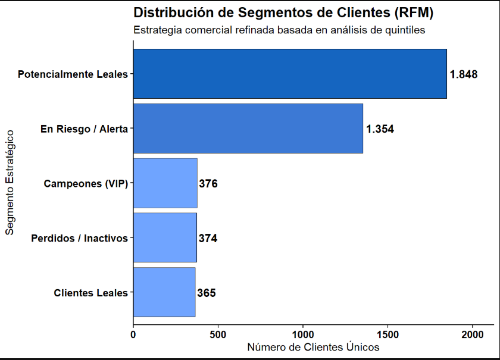
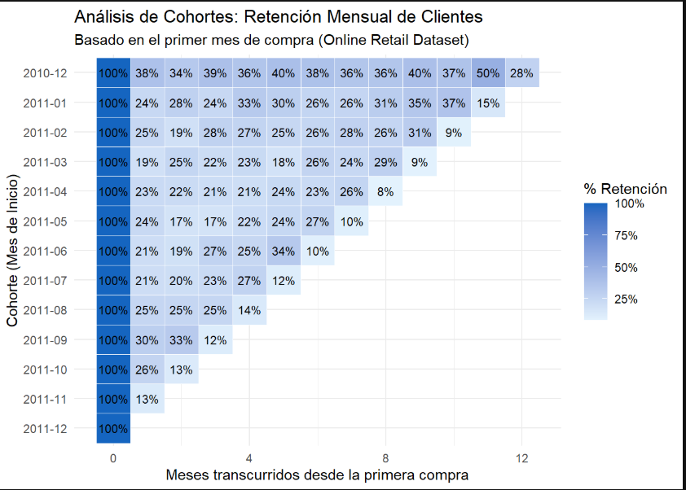
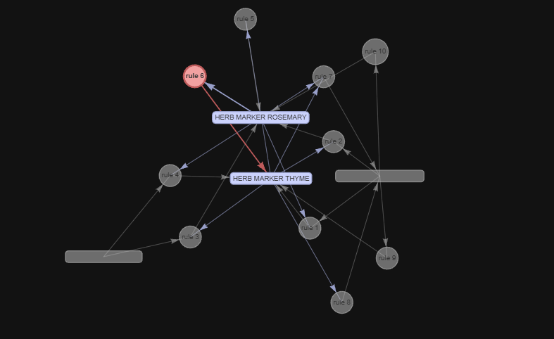

# Análisis de ventas online (Online Retail)

Análisis de transacciones de una tienda online con **SQLite** y **R**: calidad de datos, comportamiento de clientes (segmentación RFM y cohortes de retención) y productos que se compran juntos (algoritmo apriori).

> **Autor:** Miguel Sanz · Data Analyst & BI Specialist · [LinkedIn](https://www.linkedin.com/in/miguel-sanz-ba9b5b300)
> **Ver el reporte completo**: https://miguelrszzz.github.io/online-retail-analysis/outputs/reporte.html

---

## 1. Contexto y objetivo

Una tienda online necesita entender **cómo compran sus clientes** para decidir dónde enfocar sus campañas y su inventario. Este proyecto responde tres preguntas de negocio:

1. ¿Qué tipos de clientes tiene la tienda y cuáles generan más valor? (RFM)
2. ¿Qué porcentaje de clientes vuelve a comprar después de su primera compra y hay estacionalidad? (cohortes)
3. ¿Qué productos se compran juntos con más frecuencia? (apriori)

## 2. Datos

- **Fuente:** [http://archive.ics.uci.edu/ml/datasets/Online+Retail]
- **Periodo:** diciembre 2010 – diciembre 2011 (el último mes está incompleto)
- **Campos principales:** Número de factura, Código del producto, Descripción, Cantidad, Fecha de factura, Precio Unitario, ID del cliente, País

## 3. Herramientas

| Herramienta | Uso |
|---|---|
| SQLite (DB Browser) | Almacenamiento y consultas |
| R (`dplyr`, `lubridate`, `ggplot2`) | Limpieza, análisis y gráficos |
| R Markdown | Reporte final en HTML |

## 4. Estructura del repositorio

```
├── code/
│   ├── 01_conexion_sqlite.R        # Conexión a la base de datos
│   ├── 02_analisis_cohortes.R      # Retención por cohortes
│   ├── 03_algoritmo_apriori.R      # Reglas de asociación
│   ├── 04_reporte.Rmd              # Reporte completo (incluye RFM)
│   └── Ventas_online_Proyecto_1.sqbpro
├── salidas/
│   ├── reporte.html                # Reporte renderizado
│   └── cohortes_retencion.png      # Gráfico de retención
└── README.md
```

## 5. Metodología

**Limpieza de datos**
- Se excluyeron registros sin `CustomerID`, facturas canceladas y cantidades o precios no válidos.

**Segmentación RFM**
- Cada cliente se puntúa por **recencia** (días desde su última compra), **frecuencia** (número de compras) y **valor monetario** (gasto total).
- Con esas puntuaciones se agrupan en segmentos (campeones, leales, en riesgo, perdidos, etc.).

- 

**Análisis de cohortes**
- Cada cliente se asigna a la **cohorte** de su primer mes de compra.
- Se calcula cuántos clientes de cada cohorte vuelven a comprar en los meses siguientes, como porcentaje del tamaño inicial.

- 

**Algoritmo apriori**
- Se agrupan los productos por factura y se buscan combinaciones que se compran juntas.

- 

## 6. Resultados

### Segmentos de clientes (RFM)

| Segmento | Clientes | % de clientes |
|---|---|---|---|
| [Campeones] | [376]
| [Leales] | [365]
| [Potencialmente leales] | [1.848] |
| [En riesgo] | [1.354] |

- [Hallazgo: Los clientes potencialmente leales abarcan la mayor cantidad de clientes 47%, por lo que se identifica una clientela a la que se hacer enfasis y así poder traer meyores beneficios.]
- [Hallazgo: Los clientes en riesgo también representan un porcentaje alto, aproximadamente el 34%, se requiere identificar las causas que los ponen en riesgo y prestarles epecial atención. ]

### Retención de clientes por cohorte

- Entre **20% y 30%** de los clientes vuelve a comprar el mes siguiente a su primera compra.
- La retención **se estabiliza** en torno a 20-30% en lugar de caer a cero: existe una base de clientes recurrentes.
- Las compras **aumentan hacia fin de año** (septiembre a noviembre), lo que apunta a estacionalidad.
- Las cohortes de septiembre retienen mejor (30-33%) que las de primavera (17-25%).
- La cohorte de diciembre de 2010 es el inicio del dataset e incluye clientes que ya existían, por lo que no es comparable con las demás.
- La última diagonal del gráfico es baja porque el último mes del dataset está incompleto; no representa abandono real.

### Productos que se compran juntos

- Los Herb Marker (perejil, romero, tomillo y albahaca) se compran casi siempre en conjunto:
  más del 93% de confianza y un lift cercano a 78, es decir, 78 veces más probable que se compren juntos.

## 7. Recomendaciones de negocio

1. **Cuidar a los mejores clientes:** Esto se puede lograr a través de promociones o descuentos exclusivos para clientes que sean Campeones y recuperar a los clientes en riesgo con ofertas de reactivación o marketing exclusivo para ellos.
2. **Reforzar el mes 1:** lanzar una campaña de recompra pocas semanas después de la primera compra, que es cuando se pierde la mayor parte de los clientes.
3. **Preparar el pico de fin de año:** asegurar inventario y promociones entre septiembre y noviembre.
4. **Ofrecer combos:** usar las reglas de apriori para sugerir productos complementarios. Por ejemplo hacer combos de productos herb maker. 

## 8. Cómo reproducirlo

1. Clona el repositorio y descomprime los datos en una carpeta `data/`.
2. Abre `Ventas_online_Proyecto_1.sqbpro` en DB Browser for SQLite, o crea la base con el script `01_conexion_sqlite.R`.
3. Instala los paquetes: `install.packages(c("tidyverse", "lubridate", "arules", "DBI", "RSQLite"))`
4. Ejecuta los scripts de `code/` en orden numérico.
5. Para el reporte: abre `04_reporte.Rmd` en RStudio y presiona *Knit*.

## 9. Limitaciones

- El último mes está incompleto, por lo que no se interpreta la retención de ese mes.
- No hay datos de costos, por lo que el análisis se limita a ingresos y comportamiento.
- Solo se analiza un año de datos, así que la estacionalidad no se puede confirmar con otro año.
